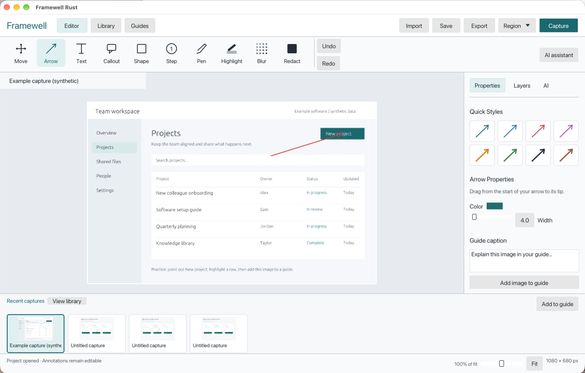
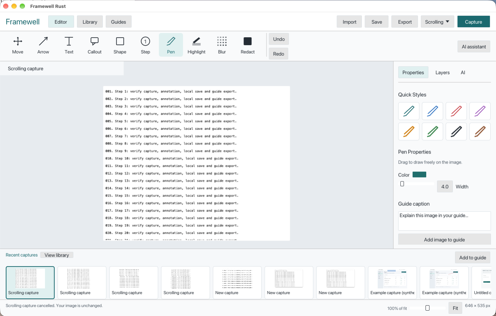

# Framewell

An open-source Rust workspace for capturing screens, adding editable explanations, and creating visual guides.

**Early rebuild, v0.1.0.** This is the beginning of a replacement for the original Swift prototype. It is not a production release or a complete Snagit/Camtasia replacement.



## What works in the prototype

- Canvas-led desktop editor with labeled vector tools, visual Quick Styles, contextual properties, layers and a recent-capture strip.
- Visual capture library with previews, editable titles, pagination and search. Saving updates the open project instead of making another library entry.
- PNG/JPEG import; arrows, rectangles, highlights, opaque redaction, text, callouts, numbered steps, pen and blur.
- Select/move/delete objects, live styling, undo/redo, editable project save/reopen and PNG export.
- macOS region/window/display capture through the operating system, with distinct permission, cancellation and failure messages.
- Guided vertical scrolling capture: select the content area, scroll downward slowly, then Finish to review a stitched image.
- Dedicated guide workspace with image snapshots, editable captions, step ordering, local save/restore and HTML+PNG export. The prototype keeps one current guide, with up to 50 steps within a total 50-million-pixel budget.
- Optional AI explanation drafts through your existing Codex CLI login. Review before applying; changes during a request discard its draft. No credentials are read from account files or committed to the project.

## Build

Rust 1.88+ and platform C/C++ build tools are required. The committed lockfile is used for repeatable builds.

```sh
cargo run --locked
cargo test --locked
```

On macOS:

```sh
./scripts/bundle-macos.sh
open 'dist/Framewell Rust.app'
```

The local bundle is not notarized. Capture requires macOS Screen Recording permission. By default the script signs ad hoc, which changes the permission identity on each rebuild. To retain permission across builds, use the same installed code-signing certificate:

```sh
FRAMEWELL_SIGN_IDENTITY='Your existing code-signing certificate' ./scripts/bundle-macos.sh
FRAMEWELL_SIGN_IDENTITY='Your existing code-signing certificate' sh ./scripts/verify-signing-continuity.sh
```

After replacing an older ad hoc build, grant the installed app access in Privacy & Security → Screen & System Audio Recording and quit/reopen it once. The VM development installation uses a persistent local certificate; public development downloads remain self-signed and unnotarized. Apple Developer ID signing and notarization remain release work.

 Linux and Windows initially support import/edit/export; native capture on those systems is future work.

For AI drafts, install and sign in to the Codex CLI yourself. `FRAMEWELL_CODEX_BIN` optionally specifies the executable. Your existing account limits apply. Clicking **Draft explanation** sends the current rendered image to the configured Codex service. The default installation also checks `$HOME/.local/bin/codex`.

## Scrolling capture

Choose **Scrolling** beside Capture. In the preview, drag over the scrolling content and exclude fixed headers, borders and scrollbars. Choose **Start scrolling capture**, scroll downward slowly in the real window while keeping at least 20% overlap, then choose **Finish**. Review the joins before sharing; **Cancel** keeps the previous image.

This first implementation captures a selected area of the primary display and stitches downward movement. It does not drive scrolling automatically or support horizontal scrolling. Animation, sticky content, large jumps and low-detail content can prevent reliable matching. Sessions stop at 80 frames, 120 seconds, 16,000 pixels in height or 40 million output pixels. Capture controls stay outside the selected area; a selection leaving no safe control position must be smaller.



## Project and privacy model

New projects live separately from the Swift prototype: `~/Library/Application Support/FramewellRust` on macOS, `~/.local/share/framewell` elsewhere. Each project contains immutable source PNG assets and an atomically published JSON manifest. Existing Swift `.framewell` documents are not modified or imported yet.

Editable projects retain source pixels. Share flattened PNGs when you need redaction: privacy masks are rendered opaque and last, even if other objects overlap them. AI receives that rendered image when requested. Blur is an aesthetic effect, not a privacy guarantee.

## Roadmap

Automatic scrolling and capture polish; crop/resize and manipulation handles; stamps; multiple named guides and richer library metadata; validated legacy import; OCR; JEV-reviewed smart annotations; OpenAI image generation and scoped pixel editing; usage accounting; Hebrew/RTL; accessibility; stable signing and installers. Recording and video timeline editing follow the capture/annotation/guide/AI foundation.

See [rebuild design and acceptance gates](docs/rebuild.md) and [verification](docs/verification.md) for observed behavior and remaining limits.

See the [Snagit workflow gap list](docs/workflow-gaps.md) for the difference between this improved workspace and a complete capture-and-annotation product. UI resemblance is not feature parity.

## Original implementation

Snagit was reviewed as a workflow reference with REA and the installed application UI. This repository contains original Rust implementation, original synthetic demo graphics and a separately licensed Ubuntu font. It contains no TechSmith binaries, artwork, decompiled implementation, private captures, API keys or account tokens.

Code: MIT. Ubuntu font: [Ubuntu Font Licence](assets/UFL.txt). Dependencies retain their own licenses.

Development/QA can set `FRAMEWELL_LIBRARY_DIR` to an isolated project directory; the normal library path is otherwise unchanged.
